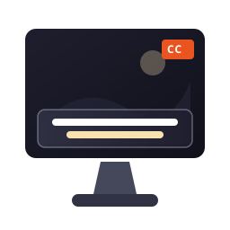

# SubtitlesOnScreen (Subtítulos en Pantalla para Ubuntu)

Una aplicación de escritorio moderna y ligera para **Ubuntu (Linux)** que muestra subtítulos flotantes semitransparentes **sobre todas las ventanas en pantalla**, con soporte para **modo transparente al ratón (Click-Through)**, sincronización milimétrica de audio y personalización visual completa.



---

## ✨ Características Principales

1. **Ventana Flotante Siempre Visible (Always-on-Top)**:
   - Permanece encima de cualquier navegador (Chrome, Firefox), reproductor de video (VLC, MPV) o aplicación.
   - Fondo personalizable (caja redondeada translúcida, banda completa o 100% transparente).
   - Tipografía ultra-legible con contorno/sombra para verse nítida sobre fondos claros u oscuros.

2. **Modo Transparente al Ratón (True X11 Click-Through)**:
   - Mediante la extensión nativa `XFixes`, cuando activas el modo **Click-Through**, todos los clics y movimientos del ratón atraviesan la ventana de subtítulos.
   - Puedes hacer clic directamente en videos, pausar Netflix o YouTube, seleccionar texto o jugar sin que los subtítulos interfieran.

3. **Modo Edición y Movimiento Libre**:
   - Arrastra la ventana a cualquier posición de la pantalla.
   - Redimensiona tirando de bordes o esquinas.
   - Gira la rueda del ratón sobre la ventana para cambiar el tamaño de la letra en tiempo real.
   - Botones rápidos para centrar abajo, arriba o al centro.

4. **Motor de Reproducción de Precisión**:
   - Cero desfase (*zero drift*) gracias a `QElapsedTimer`.
   - Soporte para archivos `.srt` y `.vtt` con autodetección de codificaciones (UTF-8, Latin-1, CP1252, etc.).
   - Reproducción, pausa, rebobinado / avance rápido (±5s), navegación por subtítulos anterior/siguiente.
   - Selector de velocidad (0.5x, 0.75x, 1.0x, 1.25x, 1.5x, 2.0x).

5. **Calibración de Sincronización de Audio (Offset)**:
   - Ajuste milimétrico de desfase en pasos de ±100 ms o ±500 ms con botón de reseteo.
   - Permite sincronizar perfectamente el subtítulo con cualquier video en streaming o archivo de audio externo.

6. **Explorador y Buscador de Diálogos**:
   - Lista completa de todos los subtítulos del archivo con marcas de tiempo.
   - Filtro de búsqueda en tiempo real.
   - Haz clic en cualquier diálogo para saltar instantáneamente a ese segundo exacto.
   - Desplazamiento automático para seguir el diálogo activo durante la reproducción.

7. **Atajos de Teclado Globales (X11)**:
   - Controla la reproducción y el bloqueo desde cualquier ventana, incluso si tienes un video en pantalla completa.

---

## ⌨ Atajos de Teclado

### Atajos Globales (Funcionan sobre cualquier aplicación en segundo plano):
| Acción | Atajo Global |
| :--- | :--- |
| **Reproducir / Pausar** | `Alt + Shift + P` |
| **Bloquear / Desbloquear Click-Through** | `Alt + Shift + L` |
| **Retroceder 5 segundos** | `Alt + Shift + Flecha Izquierda` |
| **Adelantar 5 segundos** | `Alt + Shift + Flecha Derecha` |
| **Subtítulo Anterior** | `Alt + Shift + Flecha Arriba` |
| **Subtítulo Siguiente** | `Alt + Shift + Flecha Abajo` |
| **Ajustar Sincronización (-100 ms)** | `Alt + Shift + [` |
| **Ajustar Sincronización (+100 ms)** | `Alt + Shift + ]` |

### Atajos en el Panel de Control:
| Acción | Atajo |
| :--- | :--- |
| **Reproducir / Pausar** | `Espacio` |
| **Avanzar / Retroceder 5s** | `Flechas Derecha / Izquierda` |
| **Subtítulo Siguiente / Anterior** | `Flechas Abajo / Arriba` |
| **Alternar Bloqueo Click-Through** | `Ctrl + L` |
| **Calibrar Retraso (-100ms / +100ms)** | `[` / `]` |

---

## 🚀 Cómo Iniciar la Aplicación

### Desde el Menú de Aplicaciones de Ubuntu:
Busca **"Subtitles on Screen"** en el lanzador o pulsa la tecla Super (Windows) y escribe `Subtitles`.

### Desde la Terminal:
```bash
# Lanzar normalmente
subtitlesonscreen

# O cargando directamente un archivo de subtítulos
subtitlesonscreen /ruta/a/pelicula.srt

# O ejecutando el script python:
python3 /home/carmen/subtitlesonscreen/main.py
```

---

## 🛠 Requisitos e Instalación

La aplicación utiliza Python 3 y PyQt6 (ya incluidos y configurados en el sistema).

Para reinstalar el acceso directo de escritorio o actualizar la integración del sistema:
```bash
./install_desktop.sh
```

---

## 📁 Estructura del Código

- `main.py`: Punto de entrada ejecutable.
- `subtitlesonscreen/`:
  - `overlay.py`: Ventana flotante transparente siempre visible con soporte X11 Click-Through.
  - `controller.py`: Panel de control completo con reproducción, calibrador de offset, explorador y selector de estilos.
  - `playback.py`: Motor de tiempo y reproducción de alta precisión (`QElapsedTimer`).
  - `parser.py`: Lector de subtítulos `.srt` y `.vtt` con búsqueda binaria rápida.
  - `x11_utils.py`: Integración nativa con `libXfixes` y `libX11` (click-through y atajos globales).
  - `config.py`: Persistencia de configuración en `~/.config/subtitlesonscreen/settings.json`.
- `assets/`:
  - `icon.svg` / `icon.png`: Icono oficial de la aplicación.
  - `sample.srt`: Subtítulo de prueba listo para usar.
